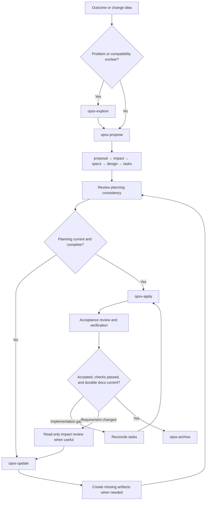

# Choose a workflow

Start with one outcome and coordinate its delivery in one change. “Record the
condition of returned equipment” starts at the return feature but also needs a
domain rule, a storage guarantee, and an HTTP mapping. Each rule stays with its
owner; one design and task list coordinate the work.

Necessary domain/port changes are included and reported with a reason. Review
dependent adapters in the same effort. Routine mappings follow the agreed contract;
choices such as whether existing callers may omit the new field need clarification.
The effort may cross contexts, technical capabilities, and system responsibilities
when the outcome requires it. Neither sharing a context nor crossing one makes
unrelated improvements part of the change.

The examples below use **Pi's `/opsx-*` commands**. These are agent prompts, not shell
commands. Other integrations may use a different spelling; see [setup](09-tooling.md).



## Define and plan a new change

Use `explore` while the problem or compatibility choices are unclear. Use `propose`
when the intended outcome is clear enough to prepare the change. With this schema,
it prepares `proposal → impact → specs → design → tasks`, stopping before code.
Clarification happens when needed; there is no separate mandatory clarify command.

```text
/opsx-propose record-return-condition: Start from lending.return.
Require a condition for each new return. Include necessary domain and port changes
and report additional owners. Discuss the compatibility of existing HTTP callers.
```

Before apply, review whether the deltas, design, and tasks agree. For a focused
requirements checklist, ask the agent to check ambiguity, failure behavior, and
compatibility now, or after a later requirements revision. Store a useful checklist
in the change; it is not a second implementation backlog or proof of acceptance.

For stepwise artifact creation, enable the optional `new`, `continue`, and `ff`
workflows. `new` starts the effort; `continue` advances an available artifact;
`ff` prepares the remaining artifacts. The terminal equivalent for discovering what
to write is `openspec status` followed by `openspec instructions <artifact-id>`.

## Refine an active change

`update` revises existing planning artifacts and reconciles their consequences.
This covers the former `update → diff → propagate` loop without a separate propagation
command. Ask for a read-only impact/diff review when you want to understand the
consequences first; the optional DDD helper supplies the consumer review set.

```text
/opsx-update record-return-condition: Refine the rejection behavior for invalid
conditions and reconcile the existing impact, deltas, design, and tasks.
```

The generated OpenSpec 1.13.1 update workflow shows revisions and confirms them
artifact by artifact. It does not create missing artifacts or additional delta
files. When a new owner needs a delta, obtain the `specs` instructions and ask the
agent to create that missing file before proceeding. A glob artifact can already
be marked done after one file exists; status cannot tell whether all owners are covered.

| State after revision | Next step |
| --- | --- |
| Existing design and tasks remain current | Review consistency, then `apply` |
| Design or tasks need revision | Reconcile them with `update`, then `apply` |
| An artifact is absent | Get its native instructions and create it; optional `continue` helps |
| Another delta file is needed inside an existing specs artifact | Get `instructions specs`, create the file, and reconcile scope/design/tasks |
| Important behavior or compatibility remains undecided | Resolve it before dependent planning or code |
| Prior effort is finished or archived | Start a new change with `propose` |

You do not repeat planning simply because a spec changed. You do need an up-to-date
design and task list before implementation. Preserve valid completed tasks; add
new work and explain any tasks reopened by the revision.

### Planning depth and readiness

All planning artifacts required for the selected change still exist before `apply`;
they need not contain an exhaustive design or every future test case. Plan the next
delivery slice in detail and keep later work coarse but actionable. Record open questions together with the
decisions or slices they block. Do not implement dependent behavior while its
contract or compatibility decision is unresolved; independent slices may proceed.

Before apply, and after scope revisions, reconcile `impact.md` with the actual work.
Review affected `openspec/system-architecture/` sections and owner-local views.
Name proposed records under the change's `architectural-decisions/`, their intended
durable scopes, and any updates to the handbook's `architectural-decisions.md` index.
Every owner marked `contract delta` needs the corresponding delta file and intended
requirement changes, not merely an existing glob artifact. Every implementation or
documentation change needs a task. Retain reasons for reviewed-but-unchanged owners.

Apply the [architecture-view rules](04-architecture-documentation.md#architecture-views-and-diagrams)
to relevant boundaries and interactions. In impact, record which views to create,
update, or reuse. In design, explain the necessary proposals and their durable
destinations. Required diagram-source updates are ordinary delivery tasks; no
separate diagram artifact, per-feature quota, or complete graphical upfront design
is required.

In `design.md`, identify how changed requirements, affected baseline guarantees,
and significant risks will be checked. Use representative success, rejection,
failure, and compatibility examples. This is a verification strategy, not a claim
of complete coverage or a second backlog. Add cases as understanding improves;
record actual execution results later in `verification.md`.

## Implement, review, and close gaps

`apply` executes the selected change's tasks. Implement useful slices across owners
instead of starting a new plan/tasks pair for every spec. For larger work, use several
sessions and reload only the relevant baseline, deltas, architecture, and task slice.
Split the effort into linked changes when outcomes can be delivered independently.

Review actual behavior against acceptance and the combined baseline plus deltas.
Run appropriate tests and record results in `verification.md`. The optional `verify`
workflow assists with conformance review; it does not replace application tests or
the project's required reviews.

For a confirmed implementation gap, add an unchecked task if existing tasks do not
cover it, then apply and review again. This is the former “converge” loop. If the
required behavior changes instead, return to the refinement workflow.

Archive after acceptance, required checks, and durable documentation are complete.
Review `openspec/system-architecture/`, local architecture, the handbook's
`architectural-decisions.md` index, and scoped `architectural-decisions/` records
against the implemented design; these updates remain explicit tasks.
The native archive workflow handles outstanding spec synchronization and archives the
change. `sync` is useful when you deliberately want the main specs updated while
keeping the change active. It is not another implementation step or an acceptance gate.

## Test-first delivery and evidence

Use test-first implementation by default for new or changed executable behavior.
For each small slice, select a requirement and example, add or adapt a test, check
that it fails for the expected reason, implement the behavior, and refactor while
keeping the tests passing. Reuse adequate existing tests rather than duplicating
them. Record a reason when test-first sequencing is not appropriate. Documentation
changes and behavior-preserving refactoring do not need an artificial red phase;
refactoring still needs suitable regression protection.

A Markdown scenario describes intended behavior; it is not an executed test. Link
important requirements to automated tests or an appropriate alternative check.
Not every scenario needs an end-to-end test: test domain rules close to the model,
orchestration at the use-case boundary, mappings at the adapter boundary, and port
guarantees through conformance tests against each applicable real adapter. Use
integration and migration tests for cross-boundary behavior and historical data.
A fake alone is not evidence that the actual storage adapter meets its contract.

### What coverage means

Planning coverage means that the next slice obligations, major risks, blocking
decisions, and verification approach are understood. It does not mean enumerating
every implementation detail, branch, or possible input before coding.

Before closure, give every added, modified, removed, or renamed requirement an
explicit evidence disposition. Include affected baseline guarantees and relevant
consumer compatibility. Evidence may be shared across requirements; a renamed
requirement does not automatically need a new test. Record passed, failed, not-run,
and partially checked results accurately, with reasons and remaining work. Accepted
limitations require an explicit acceptance decision; do not label them as passing.

Code coverage can reveal areas to inspect, but it does not demonstrate that assertions
check the intended rules. This process sets no universal percentage. Select checks
according to behavioral obligations and risk, and apply any additional project policy.
Neither a completed traceability table nor a checked task list proves conformance.

### Verification status and acceptance

Identify the checked revision, specification basis, and relevant execution context.
When checking uncommitted work, identify the base revision and the actual diff;
do not attribute those results to an unchanged commit. For documentation-only work,
identify the checked documentation revision. Reading tests or linking a test name
is not execution evidence.

Keep verification progress separate from acceptance: **Ready for acceptance** is
not **Accepted**. Record the actual project acceptance decision or its reference,
including authorized limitations and their follow-up. A required check is not
waived by checking a task box. Keep failed, skipped, and partial results visible;
recheck evidence affected by later code, contract, model, or architecture changes.
The [verification template](08-templates.md#verification-template) records these
facts without creating another pre-apply artifact or task list.

## Supporting activities

| Need | When and how |
| --- | --- |
| Clarify a business or compatibility choice | Explore before proposing, or discuss the choice during refinement |
| Requirements-quality checklist | After requirements stabilize; revisit after substantial changes |
| Analyze consistency and coverage | Before apply and after planning revisions; review proposal, impact, deltas, design, tasks |
| Architecture review | After design for significant boundaries/decisions; after implementation for conformance |
| Review delivered behavior | After apply; use tests and acceptance evidence, optionally `verify` |
| Converge on missing work | After confirmed gaps; reconcile tasks and repeat apply/review |
| Find where to resume | Native `status --all`, `list`, and per-change apply instructions |

These activities do not require a matching command for every verb. Ask the agent
for a scoped read-only review when appropriate. The bundle adds no parallel set of
`l-*` prompts. OpenSpec owns agent integration and the change lifecycle.

## Optional traceability to tests and code

Start with two useful relationships: **spec owner to code entry points**, for
navigation, and **requirement to tests or other checks**, for verification. Add
**change to pull request or commit** links for delivery history. These are different
claims; none substitutes for a recorded result against a known revision.

Start without a new manifest when existing documents suffice: use the optional
code-entry-point section in a local architecture view for navigation and link
requirements to checks and run results in `verification.md`. Add test metadata or
a manifest only when maintaining or generating those associations warrants it.
Keep each association in one editable source; result records can reference it.

A stable requirement ID is an optional project convention. Keep it when wording or
code location changes without changing the requirement identity. Record splits,
merges, and retirement explicitly. An ID in a heading does not replace the
OpenSpec requirement-name matching: introducing or renaming headings needs an explicit
migration, not an incidental edit inside a MODIFIED delta.

When adopting a manifest, generate reverse views where useful instead of manually
maintaining duplicate mappings in both tests and documents. The following is an
optional format illustration; its ID, paths, and test selector are not files or
implemented tests supplied by the worked example:

```yaml
# Optional project convention, not an OpenSpec or catalog format.
owners:
  lending.loan-store:
    code_roots:
      - src/lending/ports
requirements:
  LEND-STORE-003:
    owner: lending.loan-store
    verified_by:
      - tests/contracts/test_loan_store.py::test_atomic_return
```

Treat `verified_by` as a link to a check, not as a passing status or a claim of
complete coverage. Record actual results, commands or selectors, execution context,
and the tested revision in `verification.md` or a linked CI run. One requirement
can need several checks, and one check can cover several requirements. Avoid
manually maintained line numbers and exhaustive requirement-to-function matrices.
Executing a line does not establish that its behavior was asserted. Keep navigation,
execution observations, and conformance evidence distinct. Do not use incomplete
links as the sole basis for excluding tests from a run.

Keep these relationships out of `depends_on`, which continues to mean contract
consumption. The optional manifest is outside the helper behavior documented in this
guide. Adopting projects can add checks for unknown IDs, missing targets, and missing
verification plans for changed requirements, but introducing a file does not by
itself create a new semantic acceptance gate.

## Command responsibilities by workflow

| Workflow | Native agent operations | Main responsibility |
| --- | --- | --- |
| Understand and prepare | `explore`, `propose`; optional `new`, `continue`, `ff` | Clarify the outcome and create change artifacts |
| Refine planning | `update` | Reconcile existing artifacts without writing implementation code |
| Deliver | `apply` | Execute tasks and maintain delivery evidence |
| Verify and close | Optional `verify`, then `archive`; `sync` when needed separately | Review conformance, merge deltas, retain history |

There are no separate native `plan`, `tasks`, `checklist`, `analyze`, or `converge`
commands in this bundle. Design and tasks are schema artifacts; the other activities
are focused reviews or iterations within these workflows.
